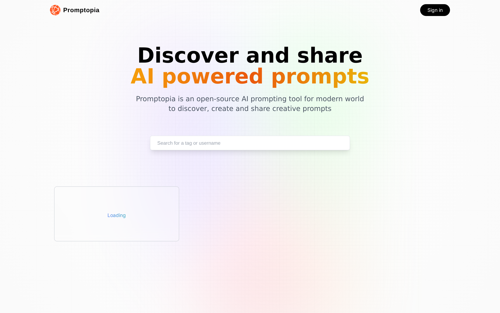
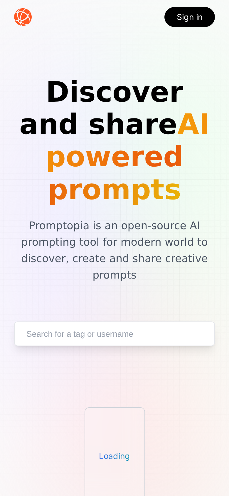

# 🚀 Promptopia

<p align="center">
  
</p>

<p align="center">
  
  
</p>

> Discover & Share AI-Powered Prompts. A modern full-stack web application built with Next.js, MongoDB, NextAuth, and Tailwind CSS.

---

## 🌐 Live Demo

👉 [Promptopia Live Demo](https://promptopia-quantic.vercel.app/)

---

## ✨ Features / ویژگی‌ها

- **English:**
  - 🔐 Google Authentication via NextAuth.js
  - 📝 Create, edit, and delete AI prompts
  - 🌍 Browse community-shared prompts with search & filtering
  - 👤 Personalized user profile management
  - ⚡ Optimized server-side rendering with Next.js App Router

- **فارسی:**
  - 🔐 احراز هویت گوگل از طریق NextAuth.js
  - 📝 ایجاد، ویرایش و حذف پرامپت‌های هوش مصنوعی
  - 🌍 مرور پرامپت‌های اشتراک‌گذاری شده جامعه با قابلیت جستجو و فیلتر
  - 👤 مدیریت پروفایل کاربری شخصی‌سازی شده
  - ⚡ بهینه‌سازی شده با Next.js App Router

---

## 🛠️ Tech Stack / تکنولوژی‌های مصرفی

- **Frontend:** Next.js, React, Tailwind CSS, TypeScript
- **Backend:** Next.js API Routes, MongoDB, Mongoose
- **Authentication:** NextAuth.js, Google OAuth

---

## 🚀 Getting Started / راه‌اندازی پروژه

### 1. Clone the repository
```bash
git clone https://github.com/sksbkt/promptopia.git
cd promptopia
```

### 2. Install dependencies
```bash
npm install
```

### 3. Configure environment variables
Create a `.env` file in the root directory and add the following keys:
```env
MONGODB_URI=your_mongodb_connection_string
GOOGLE_CLIENT_ID=your_google_client_id
GOOGLE_CLIENT_SECRET=your_google_client_secret
NEXTAUTH_URL=http://localhost:3000
NEXTAUTH_SECRET=your_nextauth_secret
```

### 4. Run the development server
```bash
npm run dev
```

Open [http://localhost:3000](http://localhost:3000) in your browser.

---

## 👨‍💻 Author / نویسنده

**Ali khoshbakht**
- GitHub: [sksbkt](https://github.com/sksbkt)
